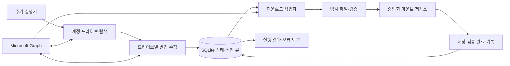

# OneDrive → 문서 중앙화 증분 백업 개념 설계

상태: 개념 설계 초안. 구현 코드와 배포 설정은 포함하지 않는다.

탐색기 열람 추가 사항: 기존 불변 버전 저장소에서 최신 파일을 `browse` 아래 계정·폴더별로 복사하여 원래 파일명과 확장자로 제공한다. 백업 실행 후 자동 갱신하며, 기존 백업에는 `browse` 명령으로 적용할 수 있다. 삭제된 원본의 마지막 백업은 별도 `deleted` 영역에 유지한다. 세부 동작은 README를 따른다.

구현 후 추가 사항: `expire_after_days` 정책과 `retention_days` 설정으로 버전 저장 완료 시각 기준 폐기를 지원한다. 파일별 최신 백업 1개는 보존 기간이나 원본 삭제 여부와 관계없이 유지하며, 만료된 이전 버전만 폐기한다. 미정 보존 일수는 빈 값으로 유지하며, 현재 구현 동작과 제한은 README의 '기간 경과 폐기'를 참고한다. 아래 내용은 최초 개념 설계 기록이다.

## 1. 목적과 범위

회사 계정들의 OneDrive 파일을 주기적으로 조회하고, 새로 생성되거나 내용이 변경된 파일만 다운로드하여 문서 중앙화 솔루션의 마운트 디스크에 저장한다.

- 구현 언어: Python.
- 상태 저장소: SQLite.
- 저장 대상: 로컬 디스크 형태로 마운트된 문서 중앙화 솔루션.
- 초기 실행: 대상 드라이브의 현재 파일 전체 백업.
- 이후 실행: 드라이브별 변경 추적을 이용한 파일 단위 증분 백업. 변경된 파일은 전체 내용을 다시 다운로드하며 블록 단위 차등 전송은 포함하지 않는다.
- 방향: OneDrive에서 중앙화 저장소로 단방향.
- 잠정 전제: Microsoft 365 조직 계정의 OneDrive for Business. 실제 테넌트 구성은 미정.

일반 파일의 내용과 복원에 필요한 식별자·경로·기본 메타데이터를 대상으로 한다. 과거 OneDrive 버전 전체, 공유 권한, 공유 링크, 휴지통, OneNote 등의 특수 항목, 외부 공유 및 바로가기 대상 포함 여부는 별도 확정한다. 주기 사이에 생성되었다 삭제된 파일이나 모든 중간 편집 버전의 보존을 보장하지 않는다.

## 2. 전체 구조



초기 형태는 단일 호스트의 Python 애플리케이션으로 한다. 하나의 드라이브에 대한 변경 수집은 직렬화하고, 파일 다운로드만 제한된 동시성으로 수행한다. SQLite 쓰기는 한 경로로 모아 경쟁을 줄인다. 웹 관리 화면과 분산 실행은 초기 필수 범위에 넣지 않는다.

| 구성 요소 | 책임 |
|---|---|
| 실행기 | 주기 실행, 중복 실행 방지, 종료 및 재시작 제어 |
| 인증 모듈 | 조직 앱 인증, 토큰 갱신 |
| 계정 탐색기 | 전체 사용자 페이지 조회, 대상 판정, 드라이브 식별 |
| 변경 수집기 | 최초 열거, delta 페이지 수집, 변경 정규화 |
| 작업 계획기 | 신규·내용 변경·이동·삭제 분류, 중복 작업 방지 |
| 다운로드 작업자 | 스트리밍 다운로드, 재시도, 파일 검증 |
| 저장소 어댑터 | 마운트 점검, 경로 변환, 임시 저장과 최종 반영 |
| 상태 저장소 | 원본 상태, 백업 상태, 작업 큐, 체크포인트 보관 |
| 운영 기록기 | 드라이브별 성공 시각, 누락·실패·지연 집계 |

## 3. 계정 탐색과 인증

사용자 로그인 없이 동작하는 조직 앱의 application 인증을 기본안으로 한다. 인증서 또는 관리 ID 등 실제 인증 수단은 배포 환경에 맞춰 확정한다. 비밀값은 소스 코드·SQLite·로그에 저장하지 않고 별도 보호 저장소에서 읽는다.

1. Microsoft Graph의 사용자 목록을 모든 페이지에 걸쳐 조회한다.
2. 대상 계정의 OneDrive를 식별하고 사용자 ID와 drive ID를 저장한다.
3. 계정 탐색을 주기적으로 반복하여 신규 계정을 자동 편입한다.
4. 드라이브 미생성, 접근 거부, 계정 삭제, 일시 오류를 구분하여 기록한다.
5. 계정이 목록에서 사라지거나 접근이 실패했다는 이유로 기존 백업을 삭제하지 않는다.

권한 후보는 사용자 목록 조회용 `User.Read.All`, 파일 조회·다운로드용 `Files.Read.All` application 권한이다. 실제 사용 API와 조직 정책을 기준으로 최종 권한 및 관리자 동의를 확정한다. 앱이 접근 가능한 범위와 애플리케이션의 백업 대상 필터는 별개로 관리한다.

참고: [사용자 목록 API](https://learn.microsoft.com/en-us/graph/api/user-list?view=graph-rest-1.0), [delta API와 권한](https://learn.microsoft.com/en-us/graph/api/driveitem-delta?view=graph-rest-1.0).

## 4. 증분 백업 처리

### 4.1 최초 실행

드라이브별 `/drives/{drive-id}/root/delta`를 토큰 없이 호출한다. `nextLink`를 따라 끝까지 수집하여 현재 파일 목록을 구성하고, 최종 `deltaLink`를 다음 변경 조회용으로 보관한다. 최초 백업에서 기존 파일을 건너뛰는 `token=latest` 방식은 사용하지 않는다.

### 4.2 이후 실행

저장한 `deltaLink`로 변경 목록을 조회한다. 링크는 불투명한 값으로 취급하여 그대로 사용한다. 파일 식별 기준은 경로가 아니라 `(drive_id, item_id)`이다. 페이지 간 동일 항목이 반복될 수 있으므로 수집 회차 전체에서 마지막 상태로 정규화한다.

| 변경 유형 | 처리 |
|---|---|
| 새 파일 | 내용 다운로드 및 저장 |
| 기존 파일 내용 변경 | 새 내용 다운로드 및 저장 |
| 이름 또는 부모 폴더 변경 | 내용이 같으면 재다운로드 없이 경로 정보 반영 |
| 폴더 이동·이름 변경 | 부모 ID 관계로 하위 경로 재계산; 자식 변경 이벤트에만 의존하지 않음 |
| 원본 삭제 | 삭제 표시 기록; 백업 파일의 실제 삭제는 보존 정책에 따름 |
| 변화 없음 | 다운로드 생략 |
| 대상 파일 유실·손상 | 원본이 있으면 재다운로드 작업 등록 |

내용 변경 판정은 파일의 `cTag`가 제공되면 우선 활용한다. `eTag`는 메타데이터 변경에도 달라질 수 있다. 내용 동일성을 판정할 정보가 부족하면 안전하게 다시 다운로드한다. 크기와 수정 시각만으로 동일성을 확정하지 않는다. 원본에서 마지막으로 관측한 태그와 실제 백업 완료한 태그를 별도로 저장한다.

참고: [delta 동작과 재동기화](https://learn.microsoft.com/en-us/graph/api/driveitem-delta?view=graph-rest-1.0), [driveItem 태그와 속성](https://learn.microsoft.com/en-us/graph/api/resources/driveitem?view=graph-rest-1.0).

### 4.3 누락 방지를 위한 체크포인트

변경 수집 완료와 파일 백업 완료는 서로 다른 상태다.

1. 각 응답 페이지와 다음 페이지 링크를 SQLite 트랜잭션으로 함께 저장한다.
2. 끝까지 수집한 회차를 정규화하여 영속 작업 큐에 반영한다.
3. 작업 반영과 새 `deltaLink` 확정은 하나의 트랜잭션으로 처리한다. 데이터가 많으면 준비 완료한 작업 묶음을 원자적으로 활성화하는 방식으로 구현한다.
4. 파일 작업이 실패해도 큐에 남아 재시도한다. 백업 완료 상태는 저장 검증을 통과한 뒤에만 기록한다.
5. 오래된 작업이 최신 완료 상태를 덮어쓰지 않도록 항목별 작업 순서와 예상 태그를 검증한다.

따라서 변경 조회 커서가 앞으로 진행되어도 미완료 다운로드가 사라지지 않는다. 재실행은 중복될 수 있지만 결과가 중복·손상되지 않는 멱등 처리를 목표로 한다.

토큰이 만료되거나 재동기화가 요구되면 현재 항목을 다시 열거하고 DB와 대조한다. 이미 백업한 내용이 동일하면 다운로드를 생략한다. 전체 열거가 정상 완료되기 전에는 목록에 없다는 이유로 삭제 판정을 내리지 않는다.

### 4.4 다운로드 중 원본 변경

스트리밍으로 내려받으며 크기와 로컬 SHA-256을 계산한다. 원본에서 비교 가능한 해시를 제공하면 함께 검증한다. 로컬 해시만으로 원본과 일치함이 증명되는 것은 아니다.

다운로드 전후 원본 태그를 비교하여 도중 변경이 관측되면 재시도한다. 지속적으로 수정되는 파일은 미완료 상태로 남긴다. 특정 버전에 고정한 읽기 지원과 과거 버전 보존은 별도 확인 항목이다. 전체 드라이브의 동일 시점 스냅샷은 이 방식으로 보장하지 않는다.

다운로드 API가 반환하는 임시 다운로드 URL은 장기 저장하거나 로그에 출력하지 않는다. 만료 시 새로 발급받는다. 참고: [파일 다운로드 API](https://learn.microsoft.com/en-us/graph/api/driveitem-get-content?view=graph-rest-1.0).

## 5. 중앙화 저장소 기록

표시용 계정명이나 이메일이 바뀌어도 경로가 흔들리지 않도록 상위 구분에는 안정적인 ID를 사용한다.

```text
<BACKUP_ROOT>/
  <TENANT_ID>/
    <USER_ID>/
      <DRIVE_ID>/
        <STORAGE_LAYOUT>/
```

`STORAGE_LAYOUT`은 미정이다. 원본 폴더 구조를 유지하는 방식과 파일 ID·버전별로 보관하고 메타데이터로 복원하는 방식 중에서, 중앙화 솔루션에서의 직접 열람 필요성과 버전 보존 정책을 기준으로 결정한다.

저장 처리 순서:

1. 마운트 식별 정보, 접근 권한, 여유 공간, 임시 파일 생성 가능 여부를 점검한다.
2. 고유 작업 ID를 가진 임시 파일로 쓴다. 완성되지 않은 파일을 최종 파일로 노출하지 않는다.
3. 파일 닫기와 크기·해시 검증 후 최종 경로로 반영한다.
4. 대상 저장소에서 읽기 검증 및 지원되는 영속화 확인을 수행한다.
5. DB에 성공 상태, 실제 저장 경로, 태그, 크기, 해시를 기록한다.

동일 저장소 내 rename의 원자성은 솔루션 검증 후 사용한다. 지원하지 않으면 고유한 새 파일에 기록한 뒤 완료 메타데이터로 공개하는 대안을 사용한다. 기존 정상 백업을 새 파일 검증 전에 제거하지 않는다.

파일 시스템 쓰기와 SQLite 커밋은 단일 트랜잭션이 될 수 없다. 작업 상태를 `pending → downloading → staged → committed`로 관리하고, 재시작 시 임시·최종 파일을 확인해 완료 기록을 복구하거나 다시 수행한다.

예약 파일명, 금지 문자, 대소문자 충돌, 긴 경로는 결정적 변환 규칙으로 처리하고 원래 이름과 실제 저장 경로를 DB에 보관한다. 원본 경로가 백업 루트 밖으로 벗어나지 않도록 검증한다.

마운트 해제, 잠금, 용량 부족, 쓰기 실패 시 완료로 기록하지 않는다. 드라이브 문자나 폴더가 존재하는지만 확인하지 말고 지정된 중앙화 저장소인지 확인해야 한다. 실행 서비스 계정에서 마운트가 보이는지도 확인한다.

솔루션이 로컬 캐시 뒤에서 비동기로 서버에 업로드한다면 파일 쓰기 성공과 서버 저장 완료를 분리해야 한다. 서버 저장 확인 방법이 없으면 결과는 '마운트 쓰기 검증 완료'까지만 표시한다.

## 6. SQLite 논리 모델

| 테이블 | 주요 필드 | 역할 |
|---|---|---|
| accounts | tenant_id, user_id, display_name, principal_name, status, last_seen_at | 계정 식별과 탐색 상태 |
| drives | drive_id, user_id, status, delta_link, last_scan_at, last_backup_at | 드라이브와 수집 체크포인트 |
| scan_batches | batch_id, drive_id, next_link, candidate_delta_link, status | 페이지 수집 및 재개 |
| scan_items | batch_id, item_id, sequence, payload | 페이지 원본과 최종 상태 정규화 |
| items | drive_id, item_id, parent_id, name, kind, source_etag, source_ctag, size, deleted_at | 마지막 관측 원본 상태 |
| backup_objects | object_id, drive_id, item_id, backed_up_tag, target_path, size, sha256, status, verified_at | 실제 저장된 내용 |
| jobs | job_id, batch_id, drive_id, item_id, action, expected_tag, state, attempts, retry_at, error | 영속 작업 큐 |
| runs | run_id, started_at, finished_at, status, summary | 실행 이력 |

`items`의 기본키는 `(drive_id, item_id)`로 한다. 작업에는 수집 회차·항목·작업 종류 기반 중복 방지 키를 두고, 버전 태그가 없는 경우도 처리한다. 시각은 UTC로 저장한다.

SQLite 실행 DB는 중앙화 마운트가 아닌 실행 호스트의 실제 로컬 디스크에 둔다. 로컬 파일 시스템에서 WAL 사용을 검토하고 짧은 쓰기 트랜잭션을 유지한다. 실행 중 DB 파일만 단순 복사하지 않고 SQLite의 일관된 백업 방법을 사용한다. DB 백업본과 복원용 메타데이터도 중앙화 저장소에 보관할 수 있도록 설계한다.

DB 유실 시 원본 재열거만으로 삭제된 파일의 메타데이터는 복구할 수 없다. DB 백업 및 저장 파일과 연결되는 복원용 manifest를 함께 보존한다. 보관 주기와 형식은 미정이다.

## 7. 오류 및 운영 상태

| 상황 | 대응 |
|---|---|
| 429 제한 응답 | `Retry-After` 준수, 동시 요청 수 축소 |
| 일시 서버 오류·네트워크 단절 | 지수 백오프와 무작위 지연, 영속 재시도 |
| 인증 만료 | 토큰 갱신 후 제한된 재시도 |
| 권한 거부 | 영향 계정·드라이브 실패 기록 및 운영자 확인 |
| 파일 조회 중 404 | 삭제·이동 등 현재 상태 재확인; 백업 삭제로 즉시 연결하지 않음 |
| 특정 파일 반복 실패 | 재시도 상한 후 별도 실패 상태; 다른 파일 진행 |
| 프로세스 종료 | 실행 중 작업 회수, 체크포인트와 파일 검증으로 재개 |
| 저장소 장애 | 새 저장 작업 중지, 복구 후 재시도; 큐·임시 공간 상한 적용 |

참고: [Microsoft Graph 요청 제한 지침](https://learn.microsoft.com/en-us/graph/throttling).

실행 결과는 '성공 / 일부 실패 / 실패'로 구분한다. 변경 조회 성공만으로 백업 성공을 표시하지 않는다. 드라이브별 마지막 수집 성공 시각, 마지막 백업 완료 시각, 가장 오래된 미완료 작업, 파일 수·용량·실패 수를 집계한다. 오류가 있는 드라이브를 전체 성공 집계에 숨기지 않는다.

원본에서 이미 삭제되어 한 번도 내려받지 못한 파일은 복구 불가 또는 정책상 별도 상태로 명시한다. 재시도 대기와 백업 성공으로 처리하지 않는다.

## 8. 삭제·이력·복원 정책

정책 확정 전에는 원본 삭제에 따른 백업 자동 삭제와 기존 버전 정리를 활성화하지 않는 설계로 한다. 이는 최종 보존 기간을 정한 것이 아니다.

최신본만 유지할지, 변경 버전을 보존할지, 중앙화 솔루션의 버전 기능을 활용할지는 미정이다. 이 결정은 저장 레이아웃과 필요 용량을 좌우하므로 구현 전에 확정한다.

복원은 계정·원본 경로·백업 시점으로 검색하고, 저장된 파일과 해시를 검증한 뒤 지정 폴더로 내보내는 흐름을 기본안으로 한다. OneDrive로 직접 되돌리는 기능과 원본 권한 복원 여부는 미정이다. 원본의 공유 권한이 중앙화 디스크에서 자동 재현된다고 가정하지 않는다.

## 9. 미정 정보 — placeholder

아래 빈 값은 의도적으로 미정이며 기본값이 아니다. 필수값과 보존 정책이 확정되기 전에는 운영 실행을 허용하지 않는 설정 검증을 둔다.

```yaml
microsoft365:
  tenant_ids:
  client_id:
  authentication_method:
  credential_reference:
  approved_permissions:
  cloud_environment:

scope:
  account_selection_rules:
  guest_account_policy:
  disabled_or_departed_account_policy:
  deleted_account_discovery_policy:
  shared_shortcuts_policy:
  special_item_policy:
  excluded_paths_or_types:

runtime:
  operating_system:
  service_identity:
  deployment_method:
  python_version:
  sqlite_path:
  staging_path:

schedule:
  account_discovery_interval:
  backup_interval:
  timezone:
  allowed_execution_window:

storage:
  solution_name_and_version:
  mount_path:
  mount_identity_check:
  storage_layout:
  atomic_rename_support:
  server_persistence_confirmation:
  filename_and_path_constraints:
  access_control_policy:
  capacity_and_free_space_threshold:

policy:
  source_deletion_handling:
  version_retention:
  retention_period:
  database_backup_interval:
  manifest_format:
  restore_destination:
  restore_to_onedrive:

operations:
  account_count:
  total_file_count_and_size:
  largest_file_size:
  daily_change_volume:
  download_concurrency:
  bandwidth_limit:
  retry_limits:
  queue_and_staging_limits:
  alert_channel_and_recipients:
  log_retention:
  recovery_point_objective:
  recovery_time_objective:
```

## 10. 구현 전 검증 항목

- 승인된 앱 권한으로 대상 계정 목록과 파일 다운로드가 가능한지 확인한다.
- 초기 백업 후 변경 없는 파일이 재다운로드되지 않는지 확인한다.
- 수정·이름 변경·폴더 이동·삭제가 기대한 정책으로 반영되는지 확인한다.
- delta 페이지 수집, 파일 저장, DB 완료 기록 사이에서 강제 종료해도 누락 없이 재개되는지 확인한다.
- 토큰 만료 시 재열거가 기존 백업의 불필요한 재다운로드나 삭제로 이어지지 않는지 확인한다.
- 실행 서비스 계정의 마운트 접근, 파일 잠금·rename·서버 저장 확인 동작을 검증한다.
- 원본이 다운로드 도중 수정·삭제되거나 저장소 용량이 부족한 경우 부분 실패가 정확히 남는지 확인한다.
- DB 백업본과 저장 파일로 실제 복원해 무결성과 경로 복원이 가능한지 확인한다.

개발 순서는 인증·마운트 검증 → 단일 계정 최초 백업 → 증분 및 재시작 복구 → 전체 계정 순회 → 운영 보고·복원 검증으로 제안한다.
